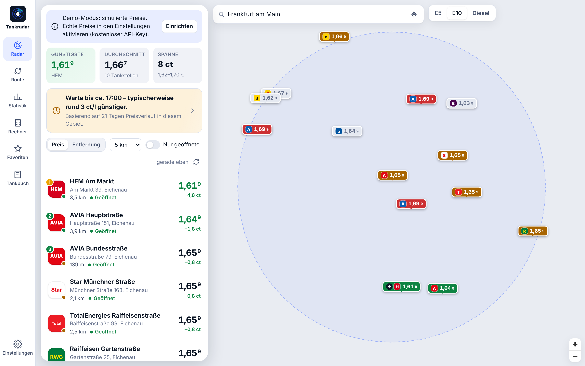
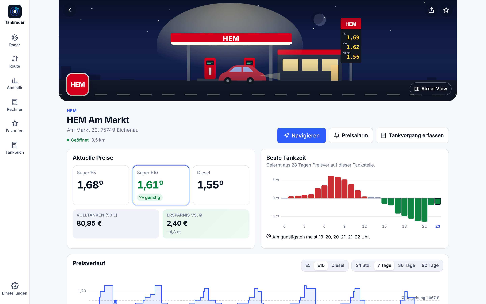
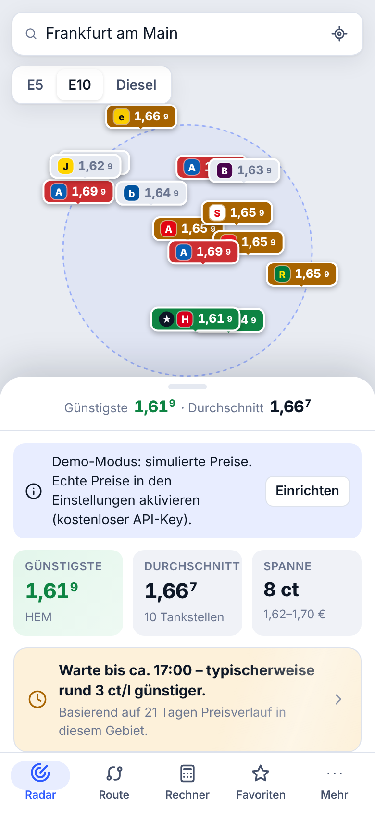
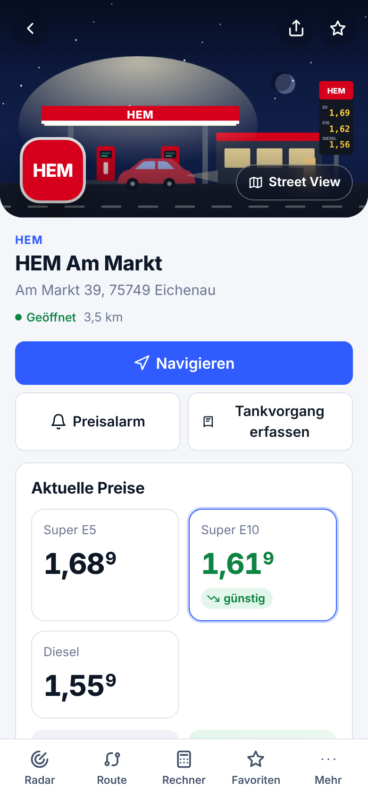
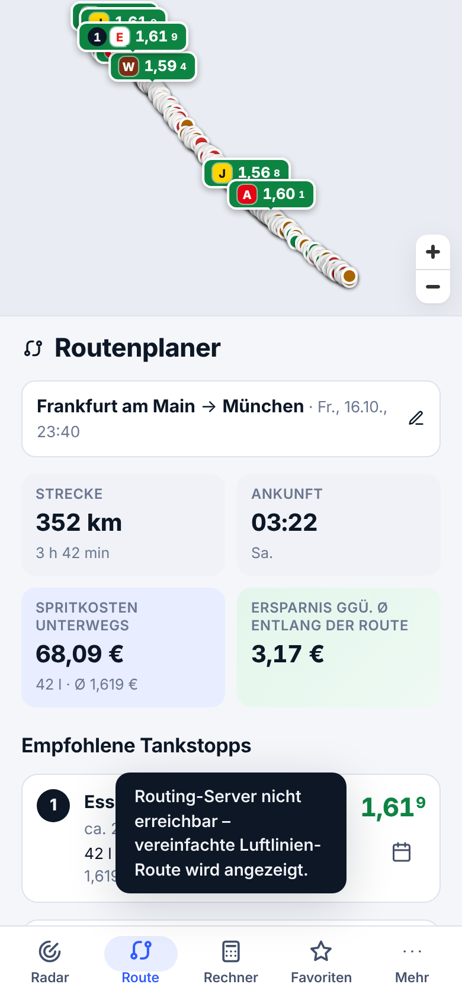
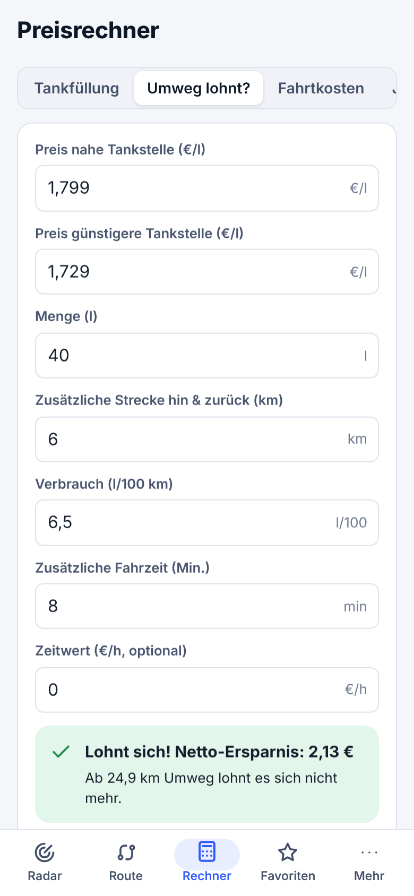
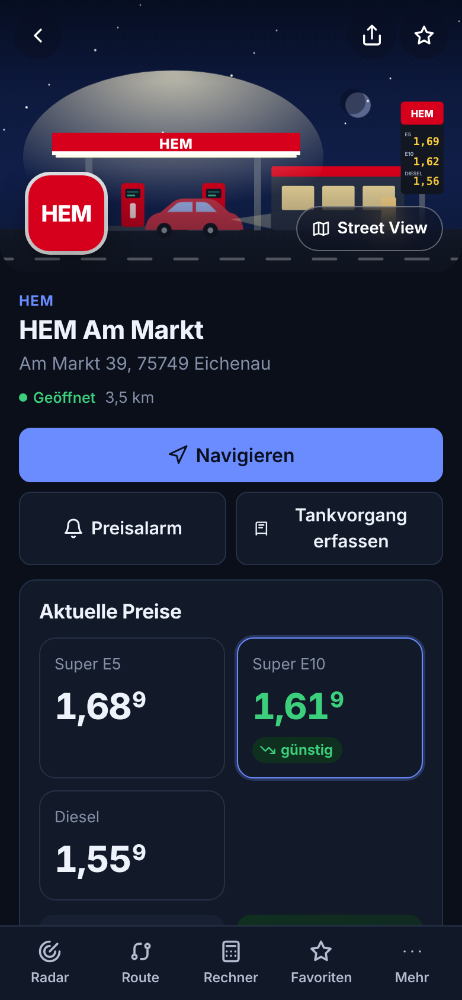

<p align="center">
  
</p>

<h1 align="center">Tankradar</h1>

<p align="center">
  <b>Günstig tanken. Zur richtigen Zeit. Am richtigen Ort.</b><br>
  Freie Open-Source-App für Spritpreise, Preisverläufe, beste Tankzeiten und die günstigsten Tankstopps auf deiner Route.<br>
  Web · Android · iOS · Windows · macOS · Linux — kostenlos, ohne Konto, ohne Tracking, ohne Werbung.
</p>

<p align="center">
  
  
</p>
<p align="center">
  
  
  
  
  
</p>

> Die Screenshots entstanden im Demo-Modus ohne Internetzugang. Darum fehlt der Kartenhintergrund; in der App siehst du eine normale OpenStreetMap-Karte.

## Funktionen

| | |
|---|---|
| 🗺️ **Radar (Karte & Liste)** | Echtzeitpreise für Super E5, E10 und Diesel. Pins und Liste sind nach *günstig / mittel / teuer* eingefärbt (immer mit Text oder Symbol, nie nur über die Farbe). Dazu Umkreis 1–25 km, Sortierung nach Preis oder Entfernung, „Nur geöffnete“ und „Hier suchen“ nach dem Verschieben der Karte. |
| 🏷️ **Logos & Außenbilder** | Jede Marke hat ein Logo in ihren Markenfarben. Auf Wunsch lädt die App das echte Logo der Marke. Tankstellenfotos kommen von Mapillary bzw. Wikimedia Commons, dazu gibt es einen Link zu Street View. Ohne Foto zeigt die App eine animierte Illustration: Himmel passend zur Tageszeit, Preismast mit den Live-Preisen. |
| 📈 **Preisverlauf je Tankstelle** | Als Stufendiagramm über 24 h und 7 Tage, als Tagesmittel mit Min/Max-Band über 30 und 90 Tage. Dazu Min, Max, Änderungen pro Tag und Vergleich mit dem Ø der Umgebung. |
| 📊 **Gebietsstatistik** | Günstigster Preis, Ø, Median, Maximum, Preisverteilung, Markenvergleich, Gebietstrend über 30 Tage und Top-10-Tabelle. |
| ⏰ **Beste Tankzeit** | Tankradar lernt das Tagesprofil jeder Tankstelle und jedes Gebiets aus dem Preisverlauf. Solange zu wenig Daten da sind, nutzt es das typische deutsche Tagesprofil. Ergebnis zum Beispiel: „Warte bis ca. 19:00 – typischerweise rund 6 ct/l günstiger.“ |
| 🛣️ **Routenplaner** | Start, Ziel, Abfahrtszeit, Fahrzeug und Tankfüllung eingeben. Tankradar sucht alle Tankstellen im Korridor um die Route, schätzt deine Ankunftszeit an jeder Station und den Preis zu diesem Zeitpunkt und berechnet per Optimierung, **wo und wie viel** du tanken solltest. Berücksichtigt werden Reichweite, Reserve, Umwege und ein Zeitwert pro Stopp. |
| 🕐 **Abfahrtszeit vergleichen** | Schätzt die Spritkosten des Plans für jede Abfahrtsstunde der nächsten 24 h und nennt die günstigste. |
| 📲 **Navi-Integration** | Google Maps (mit allen Tankstopps als Wegpunkten), Apple Karten, Waze, OpenStreetMap, Android-`geo:`-Intent (OsmAnd, Organic Maps, Magic Earth …), GPX-Export und Kalender-Erinnerung (.ics) pro Stopp. |
| 🧮 **Preisrechner** | Tankfüllung, „Lohnt sich der Umweg?“ mit Break-even-Kilometern, Fahrtkosten pro Person und Jahresersparnis. |
| ⭐ **Favoriten & Preisalarme** | Benachrichtigung, sobald eine Tankstelle (oder irgendeine im Umkreis) unter deinen Wunschpreis fällt. |
| 📒 **Tankbuch** | Tankvorgänge erfassen, Verbrauch nach der Volltank-Methode, Kosten je 100 km, Monatsausgaben und CSV-Export. |
| 🚗 **Mehrere Fahrzeuge** | Tankgröße, Verbrauch und Kraftstoff je Fahrzeug. |
| 🌗 **Alles drum herum** | Hell/Dunkel/System, Deutsch/Englisch, installierbare PWA mit Offline-Cache, Tastenkürzel am Desktop (`1`–`6`, `/` für die Suche), Onboarding und Backup/Restore als JSON. |

## Datenquellen

| Quelle | Land | Key | Hinweise |
|---|---|---|---|
| **Demo** | überall | – | Simulierte, aber realistische Preise samt Verlauf. Damit funktioniert die App sofort. |
| **[Tankerkönig](https://creativecommons.tankerkoenig.de)** | 🇩🇪 | kostenlos | Offizielle Daten der Markttransparenzstelle für Kraftstoffe (MTS-K), CC BY 4.0, alle ca. 14.500 Tankstellen. |
| **[E-Control](https://www.e-control.at)** | 🇦🇹 | – | Super und Diesel. Die API liefert nur für die günstigsten Stationen einer Abfrage Preise. |
| **Eigener Tankradar-Server** | 🇩🇪 | auf dem Server | Sammelt Preise rund um die Uhr. Dadurch gibt es vollständige Verläufe, die Daten sind für alle Nutzer geteilt gecacht und der API-Key bleibt privat. Siehe [Self-Hosting](docs/SELF_HOSTING.md). |

Auch ohne Server baut die App den Preisverlauf lokal auf: Jeder gesehene Preis landet in IndexedDB und bleibt bis zu 180 Tage gespeichert.

Karte: [OpenFreeMap](https://openfreemap.org) mit Daten von © OpenStreetMap. Routing: OSRM (FOSSGIS / Project OSRM, eigener Server einstellbar). Ortssuche: Photon / Nominatim. Alle Dienste sind kostenlos und brauchen keinen Key.

## Installation

- **Web/PWA:** Mit dem Workflow `pages.yml` wird die App auf GitHub Pages veröffentlicht. Im Browser „Zum Startbildschirm hinzufügen“ bzw. „Installieren“ wählen.
- **Android:** Die APK liegt in den [Releases](../../releases). Metadaten für F-Droid liegen unter `fastlane/`.
- **Windows / macOS / Linux:** Installer (`.msi`/`.exe`, `.dmg`, `.AppImage`/`.deb`/`.rpm`) liegen ebenfalls in den Releases.
- **iPhone/iPad:** Am einfachsten Safari → Teilen → *Zum Home-Bildschirm*. Als native App per Sideloading (AltStore, SideStore, Sideloadly) oder über TestFlight. Alle Wege stehen in [docs/INSTALL_IOS.md](docs/INSTALL_IOS.md).

## Entwicklung

Voraussetzungen: Node ≥ 22.13. Für Desktop zusätzlich Rust, für Android das Android SDK und JDK 21, für iOS Xcode.

```bash
npm install
npm run dev            # Web-App auf http://localhost:5173
npm test               # Unit-Tests (App + Server)
npm run build          # Produktions-Build nach dist/

npm run desktop:dev    # Tauri-Desktop-App
npm run desktop:build  # Installer für das aktuelle OS
npm run android        # Build + Android Studio öffnen
npm run ios            # Build + Xcode öffnen

npm run icons          # Icons, Splashscreens, OG-Bild aus assets/*.svg erzeugen
npm run screenshots    # Produkt-Screenshots (Playwright, Demo-Modus)
npm run server         # Tankradar-Server lokal starten
```

### Architektur

```
src/
  lib/          reine Logik ohne UI (getestet): Geo, Statistik, Verlauf/Tagesprofil, Tankstopp-Optimierer, Deeplinks/GPX/ICS
  providers/    Datenquellen: Demo, Tankerkönig, E-Control, Tankradar-Server
  services/     HTTP (Browser/Capacitor/Tauri), Routing (OSRM), Geocoding, Verlaufsspeicher (IndexedDB), Routenplanung, Plattform-APIs
  store/        Zustand-Stores (Einstellungen, Nutzerdaten, Live-Daten, Route)
  components/   UI-Bausteine, Karte (MapLibre), Diagramme (eigene SVG-Charts)
  screens/      Radar, Tankstelle, Statistik, Route, Rechner, Favoriten, Tankbuch, Einstellungen
server/         optionaler Self-Hosting-Server (Node 22, node:sqlite, keine Abhängigkeiten, Docker)
src-tauri/      Desktop-Hülle (Tauri 2)
android/, ios/  Mobile-Hüllen (Capacitor 7)
```

Mehr dazu in [docs/ARCHITECTURE.md](docs/ARCHITECTURE.md).

## Mitmachen

Beiträge sind willkommen, siehe [CONTRIBUTING.md](CONTRIBUTING.md). Ideen für die nächsten Schritte stehen in der [Roadmap](docs/ROADMAP.md).

## Lizenz

Code: [MIT](LICENSE). Preisdaten: Tankerkönig/MTS-K unter CC BY 4.0, E-Control nach deren Nutzungsbedingungen. Kartendaten: © OpenStreetMap-Mitwirkende (ODbL).

Tankradar ist ein unabhängiges Community-Projekt und gehört weder zur Markttransparenzstelle noch zu Tankerkönig oder einer Mineralölgesellschaft. Alle Preisangaben ohne Gewähr. Prognosen sind Schätzungen.
